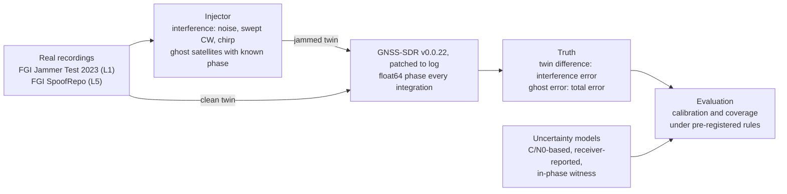
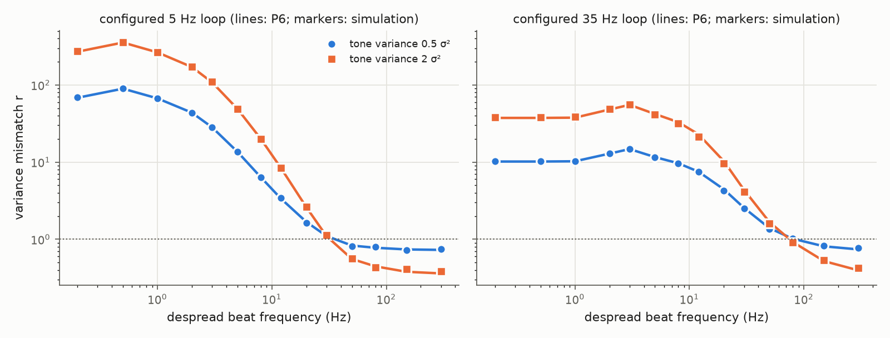
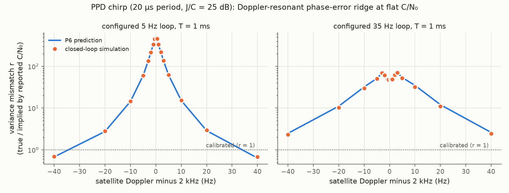
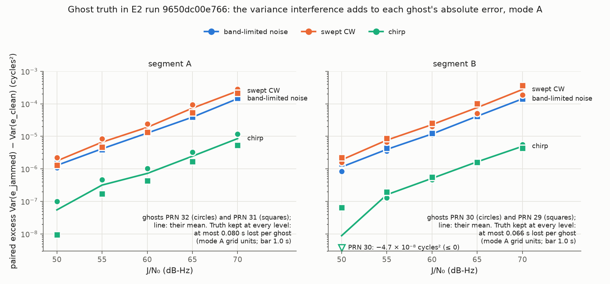
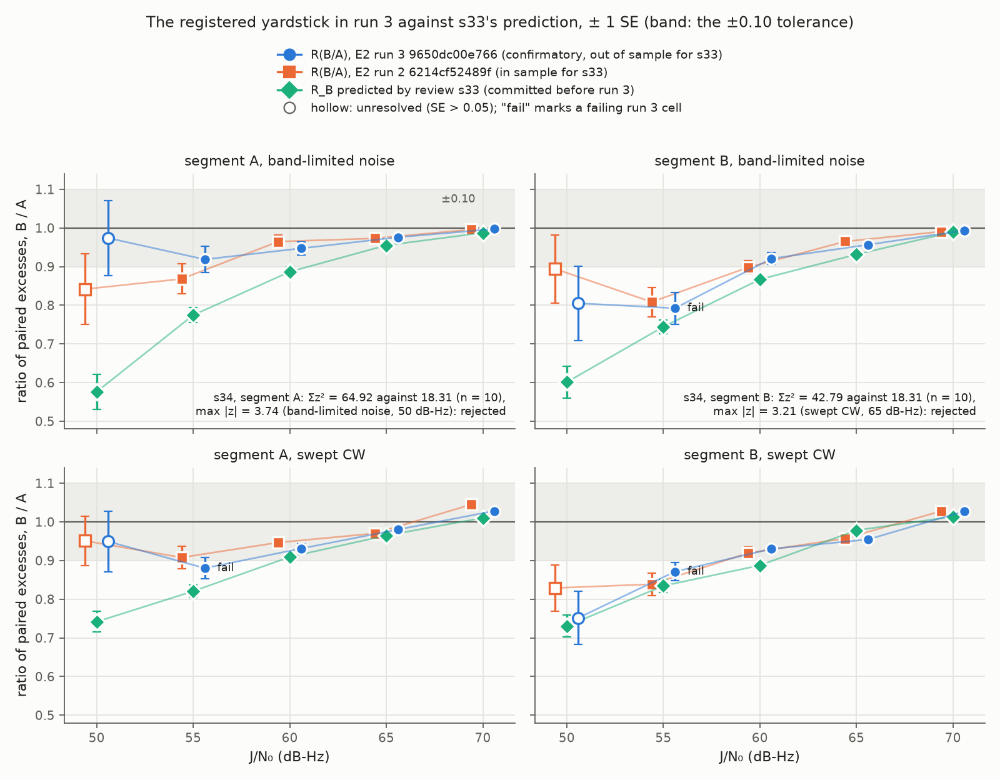

# gnss-audit

**Is the carrier-phase uncertainty that GNSS receivers report still calibrated under radio-frequency interference, and can a receiver's in-phase correlator channel give one that is?**

Carrier-phase positioning and integrity monitoring weight each measurement by a predicted variance, and that variance is nearly always a function of C/N₀. Morrison, Sokolova and Winter observed that under structured interference, C/N₀ can stay almost flat while carrier-phase noise climbs and cycle slips appear ([IET RSN 2026, doi:10.1049/rsn2.70136](https://doi.org/10.1049/rsn2.70136)). This repository holds the code, the experiment specifications and the results of a project that tests three things:

1. **Calibration.** Whether C/N₀-derived and receiver-reported phase uncertainties are calibrated under jamming.
2. **Truth.** Whether *twin-run truth* can supply the missing ground truth: the same recorded samples processed by a receiver with and without injected interference, plus synthetic *ghost* satellites whose phase is known exactly.
3. **An estimator.** Whether an estimator that reads the in-phase correlator channel, the one the phase-locked loop does not close on, recovers a calibrated per-epoch phase variance.

> **Status: research in progress, not peer-reviewed.** The theory checks and the truth-construction experiments (E0 to E2) are done. The calibration audit and the witness evaluation are still to come. Numbers below are read from the committed result files named beside them.

## How it works

Every run is a YAML manifest in `experiments/`. Its run ID is the SHA-256 of the specification, so `experiments/E2-v3.yaml` always writes to `E2/9650dc00e766`. Results are write-once, and each run records its code version, receiver image and input checksums.

## Results so far

### 1. A closed form for "flat C/N₀, collapsing phase"

The receiver's C/N₀ estimator averages over a buffer of prompts, so interference that is slow compared with the buffer reads as signal. The phase-locked loop, meanwhile, turns the same slow interference into phase error. A two-filter law (P6) predicts the resulting variance mismatch r, the true phase variance divided by the variance the reported C/N₀ implies, from the despread interference spectrum.

*CW interference at controlled despread beats, for a 5 Hz and a 35 Hz configured loop. Lines: P6; markers: nonlinear closed-loop simulation. Across 56 cells r spans 0.39 to 359. The prediction is within 1.6 % of the simulation at the median and 7.4 % at worst, and the predicted reported C/N₀ is within 0.36 dB (`review/results/s06_mismatch_law.json`).*

*A periodic jammer whose line spacing is a multiple of 1 kHz folds onto each satellite's Doppler. The case shown is a despread chirp on a pilot channel without a secondary code, simulated in closed loop.*
- *Near resonance, r reaches 456 while the reported C/N₀ stays between 45.1 and 45.5 dB-Hz.*
- *At 100 Hz or more from resonance, C/N₀ drops to 37 to 38.6 dB-Hz while r < 1, so C/N₀ models are conservative there.*
- *Within ±20 Hz of resonance the prediction is within 3 % (5 Hz loop) and 9 % (35 Hz loop) of the simulation. Far from resonance it is off by up to 27 % (`review/results/s14_doppler_resonance.json`).*

The law extends to data channels (P6′), where the data bits spread the interference. On the real GNSS-SDR binary (GPS C/A, CW at 2 to 80 Hz beats, 15 and 35 Hz loops):
- the predicted reported C/N₀ is within 0.6 dB;
- the measured r runs from 12 % below to 34 % above the prediction, where the pilot-channel form is off by up to 3.8× (`review/results/s19_data_bits_p6.json`).

The other review studies in `review/` check further propositions numerically: identifiability limits, gating, a pilot–data witness and distribution-based intervals.

### 2. Twin-run and ghost truth on real jamming recordings

E2 run 3 (`run-summaries/E2/9650dc00e766/summary.json`) processed two clean segments of FGI Jammer Test 2023 L1 recordings. It added band-limited noise, swept CW and a chirp at J/N₀ from 50 to 70 dB-Hz. All 20 integrity gates passed on both segments: twin identity, null twins, repeatability, phase precision and warm-up lock. Ghost truth was kept at every level.

*The variance that interference adds to each ghost satellite's absolute phase error, Var(e_jammed) − Var(e_clean) on paired epochs, in cycles². It rises from about 10⁻⁶ at 50 dB-Hz to 1.4 to 3.6 × 10⁻⁴ at 70 dB-Hz for noise and swept CW. For the chirp it stays a decade or more lower.*

### 3. An open question: is digital injection realistic enough?

Injecting interference into already-quantised samples cannot reproduce a real front end's AGC and requantisation. The check compares the ghosts' interference excess with requantisation behind an AGC (mode B) against plain digital injection (mode A). The pre-registered tolerance is |R − 1| ≤ 0.10.

*R(B/A) per segment, family and level, ± 1 SE, against its out-of-sample prediction (`review/results/s33_*`, `s34_*`). For noise and swept CW every cell from 60 to 70 dB-Hz passes (R between 0.921 and 1.028). At 55 dB-Hz three of the four cells fail (R from 0.79 to 0.88; noise on segment A passes at 0.919), and at 50 dB-Hz all four are unresolved. The chirp fails or is unresolved below 70 dB-Hz on both segments.*

So the pre-registered truth-fidelity gate (G3) is **not met**. Below about 60 dB-Hz, whether digital injection stands in for a real front end is still open.

All eleven figures are in `figures/`. `make figures` redraws them from the committed results in about 15 s.

## Reproducing

| Tier | What | Needs | Time |
|---|---|---|---|
| 0 | Install and run the test suite: `uv sync && make check` | Python 3.14, [uv](https://docs.astral.sh/uv/) | 3 to 5 min |
| 1 | Redraw every figure from committed results: `make figures` | tier 0 | ~15 s |
| 2 | Re-run the simulation and theory studies: `make review` | tier 0 | ~30 min on 20 cores |
| 3 | Re-run the experiments from the public recordings | Docker, the FGI downloads, many cores | hours per run |

[REPRODUCING.md](REPRODUCING.md) gives every command, the data each experiment needs, and how to check your outputs against the pinned SHA-256 values.

## Repository layout

| Path | Contents |
|---|---|
| `src/gnssaudit/` | The package. `io` holds the readers (GNSS-SDR dumps, RINEX 2/3 and Hatanaka, UBX, Fairdata), `inject` the disturbance injector, `sdr` GNSS-SDR configuration and running, `sim` the correlator and recording simulators, `truth` twin, ghost, oracle and Route D truth, `uq` the uncertainty models, `eval` scores, TOST and bootstrap, and `experiments` the experiment drivers. The `gnssaudit` CLI is in `cli` |
| `experiments/` | One YAML specification per experiment run |
| `review/` | Numerical checks of the theory (s01 to s36) and their results in `review/results/` |
| `figures/` | Every figure, drawn by `review/figures.py` |
| `run-summaries/` | The small pinned run files the E2 figures are drawn from (CC BY 4.0, see its README) |
| `registry/` | Dataset URLs and checksums, and the admitted intervals. No data |
| `containers/` | The patched GNSS-SDR image: Dockerfile, patches and digests (GPL-3.0-or-later) |
| `configs/gnss-sdr/` | Receiver configurations and their loop identifications |
| `tests/` | Unit, property, known-answer and integration tests |

Code comments cite the project's design notes as `docs/N section M`. Those notes are not part of this repository.

## Data and licences

- **Code:** MIT ([LICENSE](LICENSE)).
- **`containers/`:** GPL-3.0-or-later, like GNSS-SDR.
- **Recordings** are not redistributed. `registry/datasets.yaml` lists each dataset with its DOI, licence and checksums. The experiments here use the FGI Jammer Test 2023 Repository and FGI-SpoofRepo, both CC BY 4.0, from the Finnish Geospatial Research Institute.
- **Results derived from them** (`review/results/`, `run-summaries/`, `figures/`): CC BY 4.0.

## Citing

There is no paper yet. Please cite the repository: GitHub's "Cite this repository" button reads [CITATION.cff](CITATION.cff).
